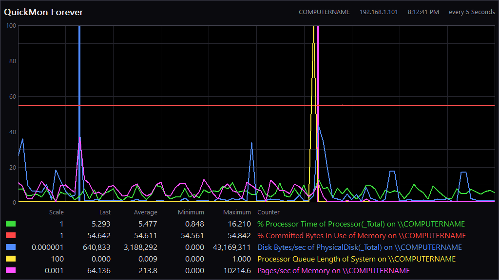
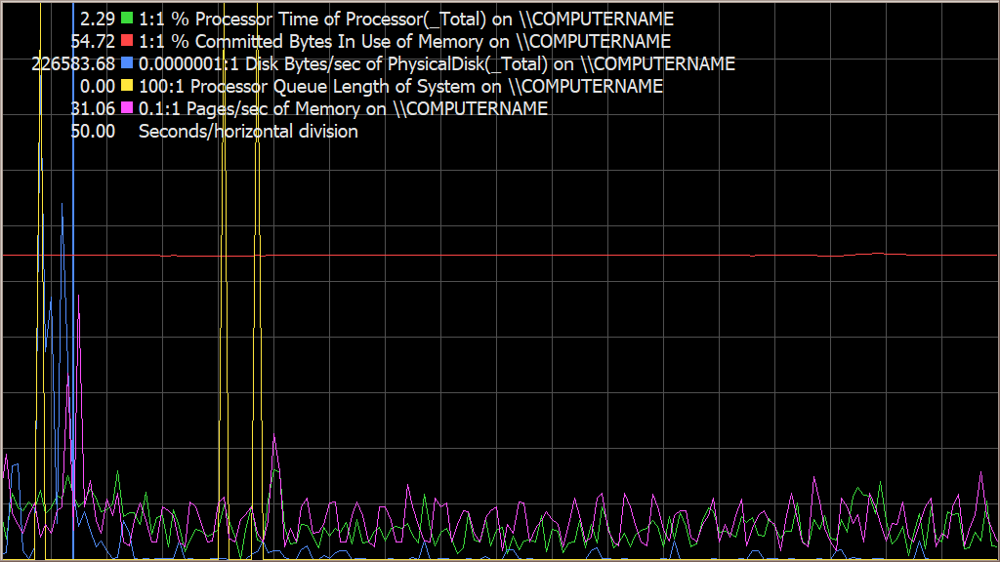
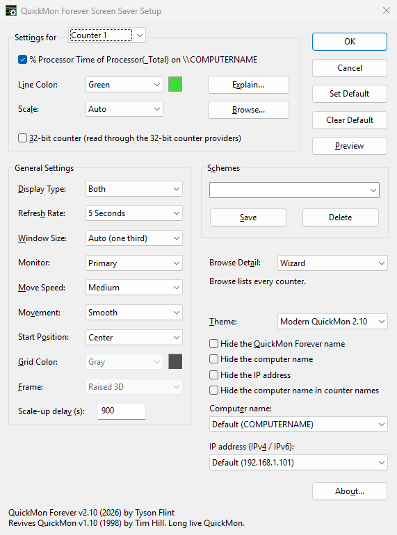
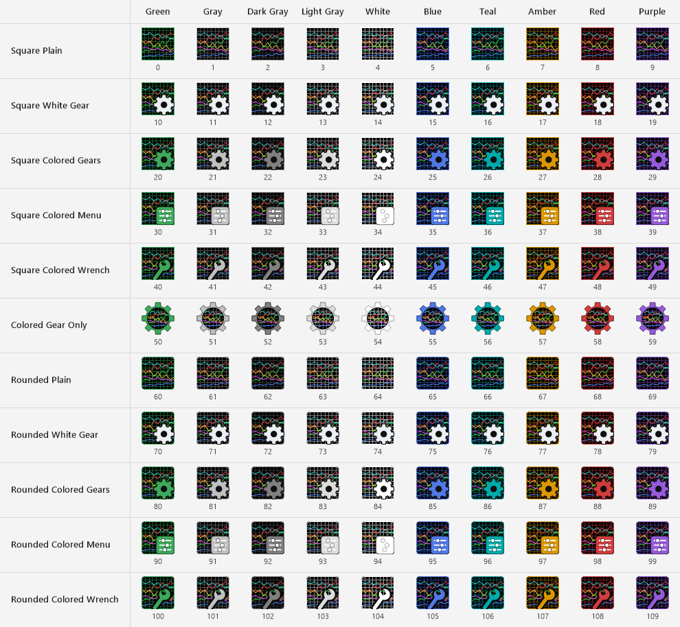

# QuickMon Forever

**Version 2.10**: the successor to **QuickMon 1.10**, the Windows NT/XP screen saver that charts
Performance Monitor counters, rewritten for Windows 10 and later. The version number
echoes the original's 1.10.

```text
1998  QuickMon v1.10 by Tim Hill
2026  QuickMon Forever v2.10 by Tyson Flint
```

No port of the original exists on GitHub (searched November 2026), so this is a
from-scratch native Win32 C++ rewrite.



*The Modern theme (the default).* The Classic theme looks like the original QuickMon 1.10:



## What it does (same as the original)

- Charts up to **8 performance counters**, local or remote (`\\SERVER\Object(Instance)\Counter`).
- Legend overlaid in the chart (Classic theme), original format:
  `4.36 ■ 10:1 % Processor Time of Processor(0) on \\MACHINE`.
- "Seconds/horizontal division" line, square gray grid (color selectable), scrolling right-to-left.
- Scaling per counter: **Auto**, **Default**, or manual 10,000,000 … 0.0000001.
- Auto-scale rules from the QuickMon manual: scale down when a value exceeds 110% of the
  chart; scale up 10x after `AutoScaleup` seconds (default 900) below 8%.
- **Rescale markers**: a thick vertical line marks each rescale, in both themes.

  | What rescaled on that sample | Marker color |
  |---|---|
  | One counter | That counter's own line color |
  | Two or more counters | White |

  The Grid Color setting does not change it: a white marker stays white on a green grid. A white
  marker doesn't say which counters rescaled; their lines jump 10x (or drop) right after it.
  Two white markers are common:
  - **At start-up**: every Auto counter chooses its first scale on the first sample.
  - **About 15 minutes in** (the Scale-up delay): every counter that has stayed below 8% since
    start-up reaches the delay on the same sample and scales up together.
- Display Type (Both / Chart / Legend), Refresh Rate (1 s – 1 h), Window Size, Move Speed
  (the window drifts around the screen to prevent burn-in).
- **Window Size**: Auto (one third of the screen each way, as on 1.10); 20%, 25%, 30%, 35%,
  40%, 50%, 60%, 70%, 80%, 90% or 100% of the screen, for very large monitors; the common Windows
  display resolutions from 3840 x 2160 down to 800 x 600 (and 960 x 600, 640 x 400), each shrunk
  to the screen if it is larger; or Full Screen. "The screen" is the chart's monitor, or the whole
  area for All monitors (see [Monitors](#monitors)). The small preview in Screen Saver Settings
  shows the chart at the same proportion and Start Position, on black. Stored as `WindowSize`;
  new sizes are added to the end of the list, so a saved size keeps its meaning.
- Named **Schemes**, **Explain...** (counter description), **Browse...** (the standard Windows
  Browse Performance Counters dialog, same as the original), Browse Detail level.
- **Set Default / Clear Default** write the logon-desktop screen saver (`HKEY_USERS\.DEFAULT`),
  which needs administrator rights. Without them, Windows' administrator prompt (UAC) appears and
  only that one change runs elevated, so it works from Screen Saver Settings → Settings… too.
  The current settings reach the elevated copy in a temporary volatile registry key
  (`HKCU\Software\QuickMonForever\SetDefault-<process ID>`), which is deleted straight after and
  which Windows discards at the next restart in any case; nothing is written to disk.
  Clear Default fully undoes Set Default: it removes the screen saver and the settings copy, and
  puts `ScreenSaveActive` back as it was. Windows 10 and 11 usually show the lock screen rather than a logon
  screen saver, so this mostly affects new profiles. **Set Default** only works once QuickMon
  Forever is installed in `C:\Windows\System32` (or another folder only administrators can change,
  such as Program Files): the sign-in screen runs it before anyone signs in, so a copy in a folder
  ordinary users can change could be swapped for another program.

## Themes

The **Theme** setting (stored as `Theme`, saved with schemes) picks how the chart window looks:

- **Modern QuickMon 2.10** (the default): this rewrite's own look. A title bar with the scheme
  name, computer name, IP address, time and refresh rate; a 0–100 axis; and a legend table under
  the chart with each counter's scale and its last, average, minimum and maximum values.
- **Classic QuickMon 1.10**: the original's look, in tribute to Tim Hill's QuickMon (1998). A
  framed chart with a square grid, and the legend over its top-left corner.

Both scroll at the same rate (10 samples per grid division) and draw the same rescale markers.
Grid Color and Frame apply only to Classic, so they are greyed out with Modern.

### Modern title bar

These are saved with schemes. All but the last apply only to Modern (greyed out with Classic):

- **Hide the QuickMon Forever name** (`HideTitle`): leaves the name out of the top-left corner;
  a scheme's name still shows there.
- **Hide the computer name** (`HideHostName`): leaves the computer name out of the top-right
  corner. The Computer name list is greyed out while this is ticked.
- **Hide the IP address** (`HideIpAddress`): leaves the IP address out of the top-right corner.
  The IP address list is greyed out while this is ticked.
- **Hide the computer name in counter names** (`HideCounterHost`, **both themes**): leaves
  " on \\\\THISPC" off the end of each counter's name in the legend, for counters read from this
  PC. Counters read from another computer keep its name, so you can still tell where they come
  from. The setup dialog always shows the full name.
- **Computer name** (`HostName`): the name in the top-right corner. Default is this PC's name;
  the list also has its full DNS name and any alternate computer names
  (`HKLM\SYSTEM\CurrentControlSet\Services\Tcpip\Parameters\AlternateComputerNames` and
  `...\LanmanServer\Parameters\OptionalNames`). A chosen name that is later removed shows as
  "(not found)".
- **IP address (IPv4 / IPv6)** (`IpAdapter`): shown between the computer name and the time.
  Default is the network card Windows uses to reach the internet, with its IPv4 address, or its
  IPv6 address if the network has no IPv4. Or pick an address: every card's IPv4 address is
  listed first, then the IPv6 addresses (global and unique local, a card's stable address before
  its temporary ones). A choice is remembered by card, so a new address from the router still
  shows; a chosen IPv6 address that is replaced falls back to that card's current one. Addresses
  are looked up every 15 seconds. Not listed: self-assigned 169.254.x.x and link-local fe80::
  addresses (a card with no network).

Older versions had a **None** entry in the Computer name and IP address lists instead of the
Hide boxes; a saved None opens as the matching Hide box ticked.

The top-right corner reads, for example:

```text
COMPUTERNAME     192.168.1.101     7:39:12 PM     every 5 Seconds
```

The clock shows seconds, in your regional time format. It updates on each refresh, and at least
every 15 seconds at slower refresh rates.

## Monitors

The **Monitor** setting (`MonitorMode`, saved with schemes) picks where the chart goes. Every
monitor it doesn't use is blacked out.

| Choice | What it does |
|---|---|
| **Primary** (default) | The chart wanders around the primary monitor |
| **1, 2, 3...** | The chart stays on that monitor. Listed as, for example, `2: 2560 x 1440 (right)`: Windows' display number, the size, and where it sits next to the primary monitor |
| **All monitors** | One chart floating across every monitor as one big screen |
| **Each monitor** | A separate chart on every monitor, each moving on its own |

- **A chosen monitor** is remembered by its hardware ID (`MonitorId`), with its display number
  (`MonitorNumber`) as a fallback, so it stays on the same screen if Windows renumbers the
  displays. If it is unplugged, the chart uses the primary monitor meanwhile, and the list shows
  it as "(not connected)".
- **All monitors** keeps the chart inside the largest rectangle the monitors fully cover, so it
  never drifts into a gap that no screen shows (monitors of different sizes, or offset from each
  other). For a layout that forms a perfect rectangle, such as a 3 x 2 grid of equal monitors,
  that is the whole desktop. Window Size percentages are of that area, and bezels split the chart
  as it crosses from one screen to the next.
- **Smooth movement** is timed to one monitor's refresh: the chosen one, or the primary one for
  All and Each monitors. On monitors with a different refresh rate the glide is very slightly
  less even; Classic movement isn't affected.
- **Start Position and movement** apply within each chart's own area: the chosen monitor, the
  covered area for All monitors, or each monitor for Each monitor. With Each monitor and Start
  Position Center, every chart heads off in its own direction, so they don't move in step.
- **The preview** in Screen Saver Settings sizes the chart against the area it will use: the
  chosen monitor, or the covered area for All monitors (the primary monitor for Primary and Each
  monitor).
- Monitor numbers are Windows' display numbers (`\\.\DISPLAYn`). These usually match the numbers
  in **Settings > Display > Identify**, but not always.
- **Tested so far** on a single monitor only: all four choices run correctly there (one chart,
  centered, moving as set). The All monitors area was checked against seven multi-monitor layouts
  (a 3 x 2 grid, six in a row, offset and mixed sizes, an L shape), but Monitor 2 and up, All
  monitors and Each monitor have not yet run on a PC with several monitors.

## Setup dialog



Every setting and button has a balloon tip explaining it, including while it is greyed out.

Each setting has its own **Alt key**, like the original's: hold Alt to see the underlined
letters, and press Alt+letter to jump to that setting (on a button, Alt+letter presses it).
Enter is OK and Esc is Cancel.

| Key | Setting | Key | Setting |
|---|---|---|---|
| N | Setti**n**gs for (counter) | O | Start P**o**sition |
| I | L**i**ne Color | G | **G**rid Color |
| L | Sca**l**e | F | **F**rame |
| X | E**x**plain... | Y | Scale-up dela**y** |
| B | **B**rowse... | C | S**c**hemes |
| 3 | **3**2-bit counter | S | **S**ave |
| P | **P**review | A | Browse Det**a**il |
| D | **D**isplay Type | T | **T**heme |
| H | Refres**h** Rate | Q | Hide the **Q**uickMon Forever name (and the other Hide boxes) |
| W | **W**indow Size | E | Comput**e**r name |
| M | **M**ove Speed | 4 | IP address (IPv**4** / IPv6) |
| V | Mo**v**ement | U | Abo**u**t... |

Alt+R and Alt+Z are not used, because NVIDIA's and AMD's overlays take them before any window
sees them. That leaves too few letters for Set Default, Clear Default, Delete and Monitor, which
have none (Delete, the one destructive button, is the safest to leave without a shortcut; every
letter in "Monitor" is taken). Tab still reaches each of them. The four Hide boxes are one group:
Alt+Q reaches the first, the arrow keys move between them, and Space ticks one.

### Line colors

Besides the 16 named colors, **Custom...** (the last Line Color entry) opens the Windows color
dialog: its color spectrum, Hue/Sat/Lum and Red/Green/Blue boxes, plus a **Hex** box added
below them. Hex follows the dialog as you click or type, and typing a hex value there (such as
`#FF8800`, `#` optional) sets the color. The Line Color entry then shows the color as hex, such
as `#FF8800`, and the square beside it shows the color. Choose the entry again, or click the
square, to change it. Stored per counter as `Counter<n>Color` = 16 and `Counter<n>RGB`, and saved
with schemes; the color dialog's 16 custom-color slots are kept in `CustomColors`.

## 32-bit and 64-bit counters

"32-bit" and "64-bit" here mean two different things: the **size of a counter's value**, and
the **bitness of the program that supplies the counter** (its provider).

### Counter values

Every counter is read as a double (`PDH_FMT_DOUBLE`), so 64-bit ("large") counters such as
`Committed Bytes` or `Disk Bytes/sec` never wrap at 4 GB the way 32-bit integer reads do. This
is the same in both builds.

### The two sides of 64-bit Windows

64-bit Windows keeps a 64-bit and a 32-bit set of counter providers. A program sees only the
set that matches its own bitness:

| Kind of counter | 64-bit side sees it | 32-bit side sees it | Example |
|---|---|---|---|
| Built-in Windows counters | Yes | Yes | Processor, Memory, PhysicalDisk |
| 32-bit-only | No | Yes | Older or third-party software with only a 32-bit provider DLL |
| 64-bit-only | Yes | No | ReadyBoost Cache (on the PC this was written on) |

Built-in counters come in both bitnesses: Windows has a 64-bit and a 32-bit version of each,
and both expose the same system performance value. So `% Processor Time` read through the
32-bit counter gives the same number as through the 64-bit one. Only a few counters, from older
or third-party software that ships just a 32-bit provider DLL, exist in 32-bit form alone: they
appear in Browse only when the **32-bit counter** box is ticked.

### How QuickMon Forever reads them

- `QuickMonForever.scr` (64-bit) reads counters itself, on the 64-bit side.
- For a slot that needs the 32-bit side, it starts **`QuickMonForever-32.exe`** hidden (no window)
  and gets that slot's values from it over a pipe on each refresh. One helper process serves
  every such slot, and it is stopped when the screen saver closes. If no slot needs it, it never
  starts. It must sit in the same folder as the `.scr`, or the **32-bit counter** box is greyed out.
- The **32-bit counter** box is per slot, so 64-bit and 32-bit counters can be mixed on one chart.
- **Ticked:** Browse, Explain and sampling for that slot go through the 32-bit side. Browse
  then lists everything the 32-bit side sees: the built-in counters as well as any 32-bit-only
  ones (but not 64-bit-only ones).
- **Not ticked:** Browse lists what the 64-bit side sees, so 32-bit-only counters are not in the
  list. If you type the path of one, or it is in a saved scheme, the screen saver finds that the
  64-bit side cannot see it and reads it through the 32-bit side automatically. Explain does the same.

### Markers

| Marker | Meaning |
|---|---|
| `[32-bit]` | The counter is read through the 32-bit side (the box is ticked) |
| `[32-bit*]` | A **32-bit-only** counter: the 64-bit side cannot see it. Read through the 32-bit side whether or not the box is ticked |

The markers appear:

- after the counter's name in the setup dialog (a long name is shortened with "..." so the
  marker stays visible), in the chart legend, and in the Explain box's title
- in the 32-bit Browse window: its title says `[32-bit]`, and each 32-bit-only object in the list
  says `[32-bit*]`. To find those, the `.scr` hands the helper the list of objects the 64-bit
  side sees, straight down a private pipe as it starts; nothing is written to disk.

`[32-bit*]` applies only to counters on this PC. Another computer's counters are read over the
network the same way from both sides, so they get `[32-bit]` at most.

### Running `QuickMonForever-32.exe` on its own

- **On 64-bit Windows** it reads every counter through the 32-bit side, so it marks everything
  `[32-bit]`, and its **32-bit counter** box is greyed out ("always on"). Use the `.scr` instead.
- **On 32-bit Windows 10** it is the screen saver (rename it to `.scr`). There is no 64-bit
  side and every counter is 32-bit, so it shows **no markers**, and the box is greyed out
  ("every counter is 32-bit"). The 64-bit `.scr` cannot run there. Windows 11 has no 32-bit
  edition.

### Remote computers

- **Remote XP machines:** pick `\\XPMACHINE` (or type it) in Browse. Remote counters need the
  Remote Registry service running on the XP machine and an account with access to it.

## Files

| File | Purpose |
|---|---|
| `build\QuickMonForever.scr` | 64-bit screen saver |
| `build\QuickMonForever-32.exe` | 32-bit counter helper; must sit next to the `.scr`. Also the screen saver on 32-bit Windows 10 |
| `src\` | Source (`QuickMonForever.cpp`, `.rc`, `resource.h`, manifest, icons) |
| `tools\MakeIcons.ps1` | Regenerates the extra icons in `src\icons\` and `src\icons.rc2` |
| `build.cmd` | Rebuild both (Visual Studio 2022 C++ tools), with the security hardening options |
| `LICENSE` | The GNU General Public License, version 3 |
| `NOTICE` | Copyright notice and the additional term (keep the credits to Tim Hill and Tyson Flint) |
| `SECURITY.md` | How to report a security problem privately, and how the program is hardened |

Settings live in `HKEY_CURRENT_USER\Software\QuickMonForever` (schemes under `...\Schemes`).
**Set Default** keeps a copy of the settings for the sign-in screen in `HKEY_USERS\.DEFAULT\Software\QuickMonForever`.

## Install

Copy **both** files into `C:\Windows\System32` from an **administrator** PowerShell:

```powershell
Copy-Item "$PWD\build\QuickMonForever.scr", "$PWD\build\QuickMonForever-32.exe" C:\Windows\System32\
```

Then open **Settings → Personalization → Lock screen → Screen saver**, pick **QuickMon Forever**,
and click **Settings...** to configure it.

System32 is also what makes **Set Default** possible: it only works from a folder that only
administrators can change (see [Security](SECURITY.md)).

**To update** an installed copy, close the Screen Saver Settings window and any QuickMon Forever
setup dialog first (the small preview keeps the file in use), then copy the new files over the old
ones the same way, adding `-Force`.

**A shortcut to the settings** needs `/c` after the file name; without it, Windows runs the screen
saver full screen. For example, target `C:\Windows\System32\QuickMonForever.scr /c`, with one of
the settings icons from [the icon list](#improvements-and-changes-from-the-original). It doesn't
need "Run as administrator" (Windows doesn't offer that for `.scr` files anyway): Set Default and
Clear Default ask for administrator rights themselves.

**To uninstall:**

1. If you used **Set Default**, click **Clear Default** first (or run
   `QuickMonForever.scr /cleardefault` from an administrator prompt), so the sign-in screen doesn't
   point at a deleted file. Pick another screen saver for yourself in Screen Saver Settings too.
2. Delete `QuickMonForever.scr` and `QuickMonForever-32.exe` from `System32`.
3. Optionally delete the settings: `HKEY_CURRENT_USER\Software\QuickMonForever`.

**Cleanup with a .reg file.** To remove every registry entry in one step (for example after the
files were deleted without running Clear Default first), save this as `QuickMonForever-cleanup.reg`
and double-click it:

```reg
Windows Registry Editor Version 5.00

; Your settings and schemes
[-HKEY_CURRENT_USER\Software\QuickMonForever]

; The sign-in screen's copy of the settings (made by Set Default)
[-HKEY_USERS\.DEFAULT\Software\QuickMonForever]

; The sign-in screen's screen saver (set by Set Default)
[HKEY_USERS\.DEFAULT\Control Panel\Desktop]
"SCRNSAVE.EXE"=-

; Your own screen saver choice (only if it is still QuickMon Forever)
[HKEY_CURRENT_USER\Control Panel\Desktop]
"SCRNSAVE.EXE"=-
```

A minus sign before a key name deletes the key and everything under it, and `"name"=-` deletes
one value. Notes:

- The `HKEY_USERS\.DEFAULT` lines need administrator rights, so Registry Editor asks with UAC when
  you open the file (or right-click it and choose **Merge** from an administrator account). Run it
  as yourself, not as another administrator: the `HKEY_CURRENT_USER` lines clean up the account
  that runs it.
- The two `SCRNSAVE.EXE` lines clear the screen saver whichever one is chosen, so leave out a
  section if you have since picked a different screen saver there. Without a `SCRNSAVE.EXE` value,
  Windows uses no screen saver.
- Unlike Clear Default, the file doesn't put back the sign-in screen's earlier **ScreenSaveActive**
  setting (Set Default turns it on). That only matters if you want the sign-in screen saver off
  rather than just empty; with no `SCRNSAVE.EXE`, nothing runs either way.
- Deleting a key that isn't there is harmless, so the file is safe to run more than once.

## Improvements and changes from the original

- Native **64-bit** screen saver, plus a 32-bit helper for counters from 32-bit-only providers.
- 64-bit counter values read as doubles, so large counters never wrap at 4 GB.
- Uses the **PDH.DLL built into Windows**. The original shipped its own 1997 copy, which
  had to be copied into the Windows folder.
- Per-monitor **DPI awareness** and Windows visual styles (the original was drawn in
  Windows Classic style at 96 DPI).
- Works across **multiple monitors**: covers the whole desktop, with the chart on the primary
  monitor, a chosen monitor, floating across all of them, or one on each; see [Monitors](#monitors).
- Settings move from `HKCU\Control Panel\Screen Saver.QUICKMON` to `HKCU\Software\QuickMonForever`.
  The scale-up delay (`AutoScaleup`), a registry-only value in the original, is in the dialog.
- New **About...** button in the setup dialog with credits.
- The **Browse Performance Counters** dialog is resizable (size grip in the corner; the lists
  and description grow) and remembers its size. It explains each counter detail level next to
  the drop-down, with tooltips on the detail level and the instance search box.
- **Browse Detail** in the setup dialog shows what the selected level means (tooltip has all levels).
- **Two themes**: Modern (the default) and Classic, the original's look; see [Themes](#themes).
  Modern's title bar can hide the name and shows a chosen computer name and IP address.
- Every setting and button in the setup dialog has a balloon tip, and every setting has an
  **Alt key**; see [Setup dialog](#setup-dialog).
- **Custom line colors** in any RGB value, picked in the Windows color dialog with an added Hex
  box; see [Line colors](#line-colors).
- A **command line** for one-off runs and scripted changes to the theme, schemes and counters;
  see [Command line](#command-line).
- **Set Default / Clear Default** ask for administrator rights with the Windows UAC prompt when
  needed, only work from a protected folder, and Clear Default fully undoes Set Default.
- **Built to be safe**: hardened builds (Control Flow Guard, shadow-stack compatible, ASLR, DEP),
  system DLLs loaded only from System32, no network connections of its own, and no temporary
  files (its parts talk over private pipes); see [SECURITY.md](SECURITY.md).
- **Free software under the GNU GPL v3**, keeping the original's freeware spirit, with a license
  term that keeps the credit to Tim Hill; see [License](#license).
- New **Grid Color** setting: Gray (the original, and the default), Dark Gray, Light Gray, Green,
  Blue, Teal, Amber, Red, Purple, or None. Stored as `GridColor` and saved with schemes. The
  window border follows it (a brighter shade of the same color).
- **Movement** style (stored as `MoveStyle`):
  - **Smooth** (default): the window glides, moving once per display refresh in even 1-pixel steps.
  - **Stepped**: glides on a 33 ms timer, which really fires about every 47 ms and moves in
    2–3 pixel jumps, so thin grid lines can seem to flicker.
  - **Classic**: like QuickMon 1.10, the window stays put and jumps 5 pixels diagonally
    (bouncing off the edges) every 5 seconds at Fast, 15 at Medium and 30 at Slow, whatever the
    refresh rate. Measured on 1.10, including Medium at both a 5-second and a 1-second refresh.
    The jump scales with screen height (5 px at 1080 lines, 7 at 1440).
  - **Classic (5 px)**: the same, but always exactly 5 pixels, like the original.
- **Frame** (stored as `FrameStyle`): Raised 3D (default), like 1.10, which draws a raised 3D
  edge, 3 pixels on the top and left and 2 on the right and bottom (the original's colors with
  the Gray grid, matching shades otherwise); or Flat, a 2-pixel border in a bright shade of the
  grid color.
- **Start Position** (stored as `StartPosition`): Center (default), Top Left, Top Center or
  Top Right. The window moves away from where it starts (down-right from Top Left, as 1.10
  does; down-left from Top Right; down from Top Center). Applies to every Movement style.
- Its own icon (`src/QuickMonForever.ico`): the chart with a green grid and border, square, 16–256 px.
  Both the `.scr` and the `.exe` carry 109 more icons for shortcuts, chosen by index (e.g.
  `QuickMonForever.scr,10`) or with Change Icon. Every design comes in ten colors, always in this
  order: Green, Gray, Dark Gray, Light Gray, White, Blue, Teal, Amber, Red, Purple (the Grid
  Color list's order, with Green, the main icon's color, moved to the top and White added).
  The gear, sliders and wrench take the frame color (red grid, red wrench), except the white
  gear. All the square icons come first, then the same icons with rounded corners.

  | Index | Icon |
  |---|---|
  | 0–9 | The chart, square (0, green, is the main icon) |
  | 10–19 | Settings, square: chart with a white gear (10, green, is the setup dialog's own icon) |
  | 20–29 | Settings, square: chart with a colored gear |
  | 30–39 | Settings, square: chart with a sliders tile |
  | 40–49 | Settings, square: chart with a wrench |
  | 50–59 | Settings: the chart inside a gear (already round, so it has no rounded version) |
  | 60–69 | The chart, rounded |
  | 70–79 | Settings, rounded: chart with a white gear |
  | 80–89 | Settings, rounded: chart with a colored gear |
  | 90–99 | Settings, rounded: chart with a sliders tile |
  | 100–109 | Settings, rounded: chart with a wrench |

  

  The last digit gives the color: 0 Green, 1 Gray, 2 Dark Gray, 3 Light Gray, 4 White, 5 Blue,
  6 Teal, 7 Amber, 8 Red, 9 Purple. For example, index 48 is the red square wrench. The extra
  icons are drawn by `tools\MakeIcons.ps1`, which writes `src\icons\` and `src\icons.rc2`.
- Not included: the original's Help file. The balloon tips, `/?` and this README cover the same
  ground.

## Credits

- **QuickMon 1.10**, the *QuickMon Performance Monitor Screen Saver for Windows NT*, was
  originally written by **Tim Hill**, Copyright (c) 1998 Tim Hill, all rights reserved. It was
  distributed as freeware (`qmon110.zip`) through
  [c2000.com](https://web.archive.org/web/20050509232759/http://www.c2000.com/software/software.htm),
  which listed it as "NT Screen Saver Monitor".
- **QuickMon Forever** was rewritten by **Tyson Flint**, 2026.

QuickMon Forever is an independent rewrite based on the original's user manual and observed
behavior. It contains no code, text, or files from the original QuickMon. The original
program is not redistributed here.

## License

QuickMon Forever is free software, released under the
[GNU General Public License, version 3](LICENSE) or (at your option) any later version.
Copyright (C) 2026 Tyson Flint.

QuickMon 1.10 was freeware: free for anyone to download and use. The GPL keeps QuickMon Forever
the same way. Anyone may use, copy, change and share it, but every copy and every changed
version must stay free software under the same license, with its source code available, so it
can't be turned into a closed, paid product.

**Additional term (section 7(b) of the GPL, in the [NOTICE](NOTICE) file).** Every copy and
every modified version of QuickMon Forever must keep these author attributions, in its
documentation and in its About box:

- "Based on QuickMon 1.10 by Tim Hill (1998)."
- "Copyright (C) 2026 Tyson Flint."

Modified versions may add their own credits alongside these, but may not remove them. The term
asks only that the credits be kept; it adds no other restriction to the GPL.

This license covers only QuickMon Forever, the code in this repository. It does not cover the
original QuickMon 1.10, which remains Copyright (c) 1998 Tim Hill, all rights reserved, and
contains none of its code.

## Command line

Both `QuickMonForever.scr` and `QuickMonForever-32.exe` take these. Switches start with `/` or
`-` and are not case-sensitive. Put quotes around names and paths that contain spaces.
`/?` or `/help` shows this list in a message box.

**Screen saver** (what Windows uses):

| Switch | Action |
|---|---|
| `/s` | Run full screen |
| `/c` | Setup dialog (also with no arguments) |
| `/p <hwnd>` | Preview inside the Screen Saver Settings window |

Only the single letter counts: `/settings` or `/start` is not taken for `/s`. An unknown switch
shows the help with an error instead of doing anything.

**Theme and scheme.** Without `/save` these run the screen saver once, full screen, with the
change; nothing is saved. With `/save` the change is saved and nothing runs.

| Command | Action |
|---|---|
| `/theme modern` or `/theme classic` | Run once with that theme |
| `/theme modern /save` or `/theme classic /save` | Save it as the screen saver's theme |
| `/scheme <name>` | Run once with that scheme |
| `/scheme <name> /default /save` | Make it the screen saver's scheme (`default` without the slash works too) |
| `/scheme <name> /counter:<1-8> <path> /linecolor <color> /scale <scale> /save` | Change the scheme's counters and save the scheme |

- `/counter:<1-8>` picks a counter; the path, `/linecolor` and `/scale` after it are each
  optional and apply to that counter. Repeat `/counter:<1-8>` to change several.
- Add `/default` to also make the changed scheme the screen saver's scheme. Without `/save`,
  it runs once with the changes.
- Without `/scheme`, `/counter` changes the screen saver's current settings (with `/save`) or
  runs once with them.
- Scheme names are matched without regard to case; the scheme must already exist (create it with
  **Save** in the setup dialog).
- Colors: Red, Green, Blue, Yellow, Magenta, Cyan, White, Orange, Lime, Pink, Purple, Sky, Gold,
  Teal, Gray, Brown, or any color as hex, `#RRGGBB` (the `#` is optional, letters any case):
  `/linecolor red` and `/linecolor #FF0000` both work. Scales: `Auto`, `Default`, or
  `10000000` … `1` … `0.0000001`.
- `/default` here means "the scheme the screen saver uses for you". It is not the setup
  dialog's **Set Default** button, which sets the sign-in screen's screen saver.

Example:

```text
QuickMonForever.scr /scheme "Disk activity" /counter:2 "\PhysicalDisk(_Total)\Disk Bytes/sec" /linecolor Blue /scale 0.000001 /default /save
```

**Test aid:**

| Command | Action |
|---|---|
| `/render <file.bmp> <width> <height> <samples>` | Sample once a second, then write the chart to a BMP. Works with `/theme`, `/scheme` and `/counter` for a one-off look |
| `/showname <name>` and `/showip <address>` | For screenshots: show these instead of this PC's name (in the title bar and in each counter's "on \\\\NAME") and IP address. One-off runs, `/render`, and the setup dialog with `/c` (for its screenshot); never saved |

The screenshots in this README were made this way, with the default settings:

```text
QuickMonForever.scr /theme modern /showname COMPUTERNAME /showip 192.168.1.101 /render screenshot.bmp 1024 576 110
```

The Modern chart shows 100 samples across its width and the Classic chart (at this size) about
180, so 110 and 200 samples fill them.

Exit codes: 0 when it worked, 1 for a mistake on the command line (shown in a message box).

**Internal switches.** The program uses these between its own parts; they are listed here so
they make sense when seen in Task Manager or in the code, not to be typed. They show no help and
report their result only as an exit code.

| Switch | Used by | What it does |
|---|---|---|
| `/helper32` | The `.scr`, for 32-bit counters | Starts `QuickMonForever-32.exe` as the hidden helper that reads 32-bit counters while the screen saver runs, answering over private pipes |
| `/browse32 <window> <detail> <list> <path>` | Browse, with the 32-bit counter box ticked | Shows the Browse window on the 32-bit side. When `<list>` is 1, the 64-bit side's objects arrive on its standard input (a private pipe), to mark the 32-bit-only ones `[32-bit*]` |
| `/explain32 <window> <only32> <path>` | Explain, for a 32-bit counter | Shows the counter's description from the 32-bit side |
| `/check32 <path>` | The setup dialog | Exit code 0 when the 32-bit side can read that counter (used for the `[32-bit*]` marker) |
| `/setdefault <SID> SetDefault-<id>` | Set Default, through the UAC prompt | Run with administrator rights: copies the settings from the volatile key `HKEY_USERS\<SID>\Software\QuickMonForever\SetDefault-<id>` and sets the sign-in screen saver. Only works from a protected folder |
| `/cleardefault` | Clear Default, through the UAC prompt | Run with administrator rights: clears the sign-in screen saver and the settings copy, and puts `ScreenSaveActive` back as it was |

`/cleardefault` is also handy on its own: run from an administrator prompt, it clears the
sign-in screen saver without opening the setup dialog (exit code 0 when done, 5 without
administrator rights).

Note: double-clicking a `.scr` (or `Start-Process` on it) runs it **full screen** and ignores any
switches, because Windows starts it with `/s`; right-click → **Configure** opens the setup dialog.
